# AVA Spy Hunter

[](https://github.com/Harlock123/AVASPYHunter/actions/workflows/build.yml)

A road-combat chase in the style of Bally Midway's 1983 arcade game **Spy Hunter**, built with .NET
10 and Avalonia UI. Drive a winding road that never ends. Run the raiders off it, shoot them, or drop oil and
smoke in their path, but spare the innocent drivers or your score stops counting. When the road runs
into a boathouse, your car becomes a boat.

## Features

- **The road**, laid down as you drive:
  - **Its shape:** it winds, narrows and widens, forks round a median, and crosses narrow bridges with water either side.
  - **The river:** now and then it runs into a boathouse, and you take to the river as a boat until the landing.
  - **Four stretches of country** in turn: the Coast Road, Pine Pass, the Winter Run (on ice the car slides), and the Night Drive (just your headlights, and other cars' lights in the dark).
- **The raiders**:
  - **Razorwheels** draw alongside and run blades out of their hubs: you can see the blades coming. Ram one before they're out, or swerve away and let its lunge miss.
  - **Bulldogs** are armoured rammers. Bullets bounce off them, so bump them off the road or oil them.
  - **Sedans** carry a gunman who leans out and takes aim before he fires. It takes three hits to stop one.
  - **The helicopter** hangs ahead and drops bombs that leave craters in the road. Watch for the bomb's shadow growing. Only missiles can bring it down.
  - **On the river**, barges roll drums into the water behind them, and torpedo boats fire up the river from behind you.
- **The innocent**: ordinary drivers and pleasure boats. Harm one, by gunfire or by running it off the road, and your score stops for eight seconds.
- **The armoury van**: every half-minute or so it overtakes you and slows to let you catch it up. Drive up its ramp to take on a special weapon, in turn:
  - **Oil slick:** whoever follows spins out.
  - **Smoke screen:** pursuers lose the road.
  - **Missiles:** they seek the helicopter, or the nearest raider.
- **Free time**: for the first ninety seconds a wreck costs nothing. After that you have three cars, and an extra one at 20,000 points and every 30,000 after.
- **Sound**: an original driving theme over a surf-guitar bass, and sounds for the guns, ricochets, wrecks, skids, splashes, the helicopter and its bombs, the van, and changing to a boat and back. All mixed by OpenAL.
- **Attract mode**: leave the title alone for 15 seconds and a computer driver takes the wheel. It:
  - steers round traffic, bombs and drums
  - rams razorwheels before their blades come out, and swerves away from them after
  - brakes to let a chaser by
  - catches the armoury van
  - shoots only when no innocent is in the way
- **A top-ten high-score table** with arcade-style initials entry; it records the sector reached.
- **Gamepads** through SDL2, as well as the keyboard.
- **Any window size**: the screen scales to fit, letterboxed. **Ctrl+S** saves a screenshot.
- **One self-contained executable** per platform: Windows, macOS and Linux on Intel/AMD and ARM.

## Screenshots

| The title | Rolling out | On the Coast Road |
|:---------:|:-----------:|:-----------------:|
| 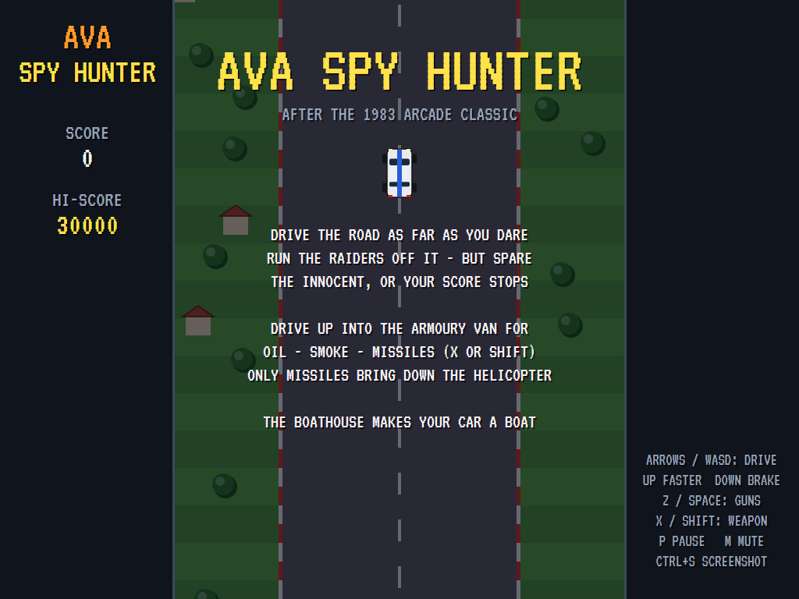 | 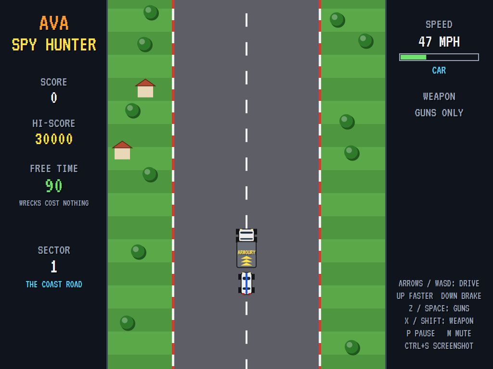 | 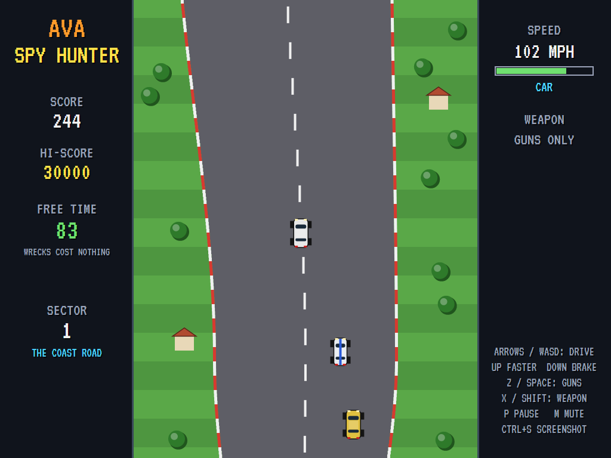 |
| The rules on the road. | Out of the back of the armoury van. | Innocent and not. |

| The armoury van | Blades out | A fork |
|:---------------:|:----------:|:------:|
| 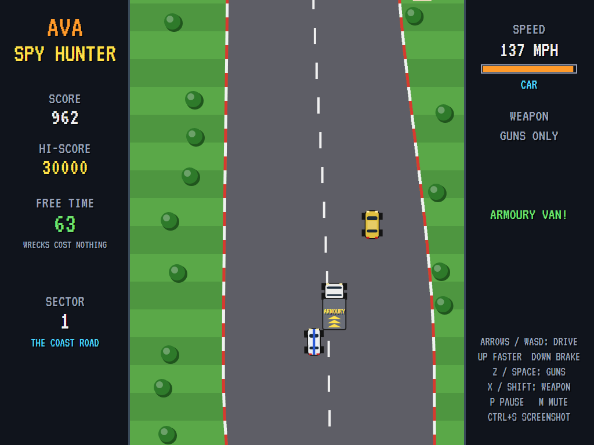 | 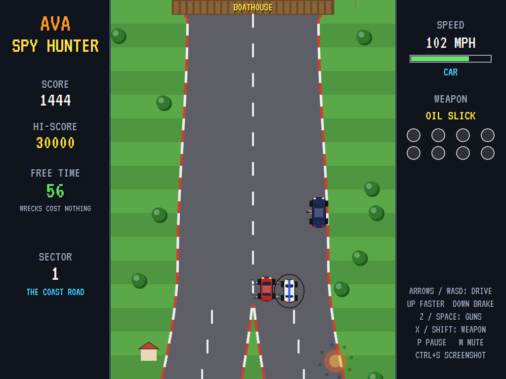 | 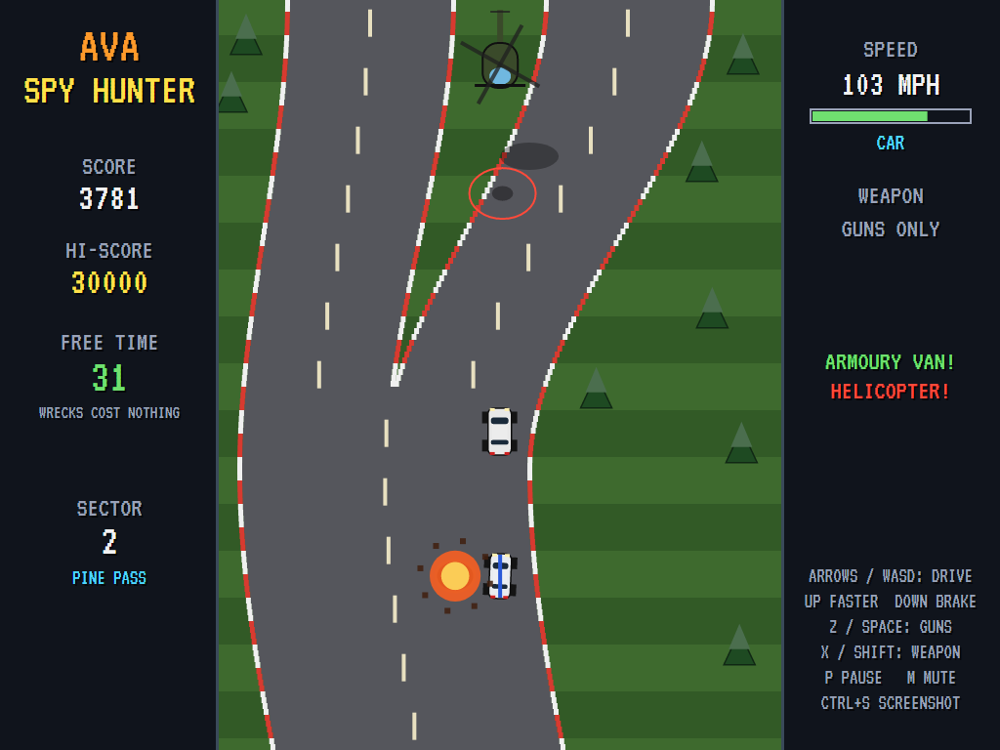 |
| Up the ramp for a weapon. | A razorwheel alongside, a gunman leaning out, a boathouse ahead. | The road splits round a median. |

| The helicopter | The river | The Winter Run |
|:--------------:|:---------:|:--------------:|
| 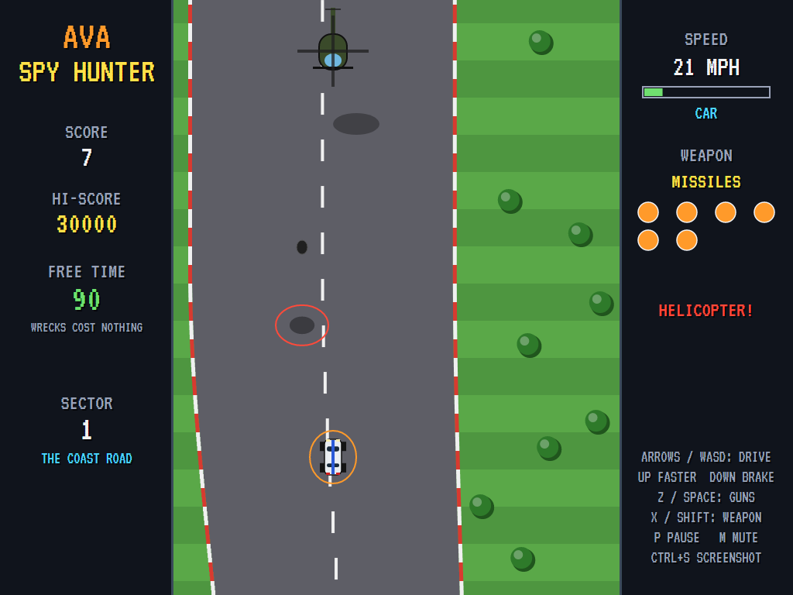 | 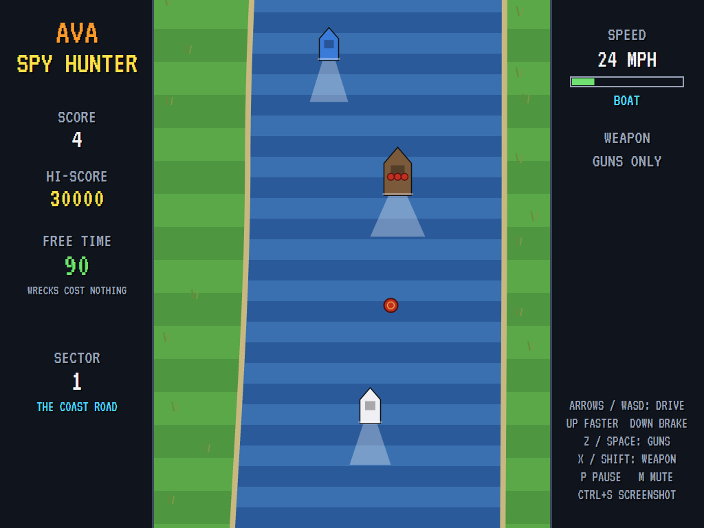 | 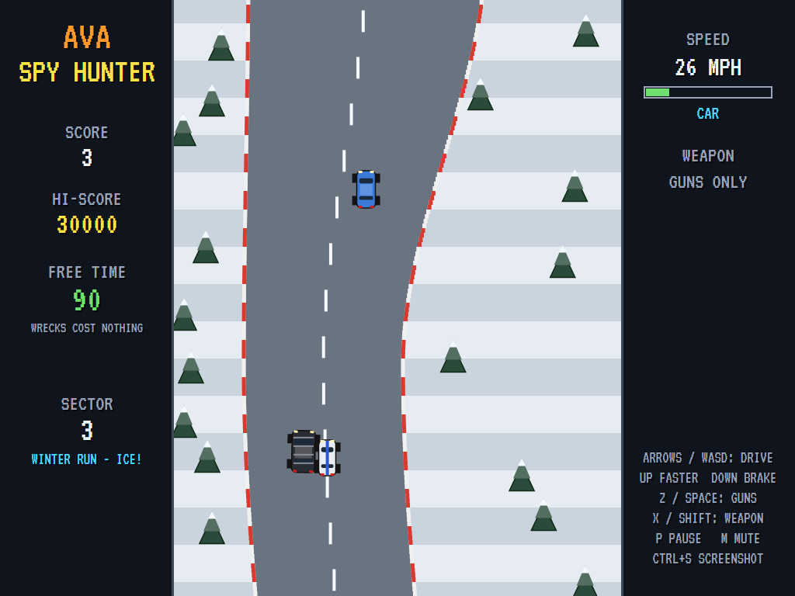 |
| A bomb's shadow growing on the road, and missiles ready. | A drum in the water, and the barge that dropped it. | Ice, and a bulldog alongside. |

| The Night Drive | The best agents | |
|:---------------:|:---------------:|:-:|
| 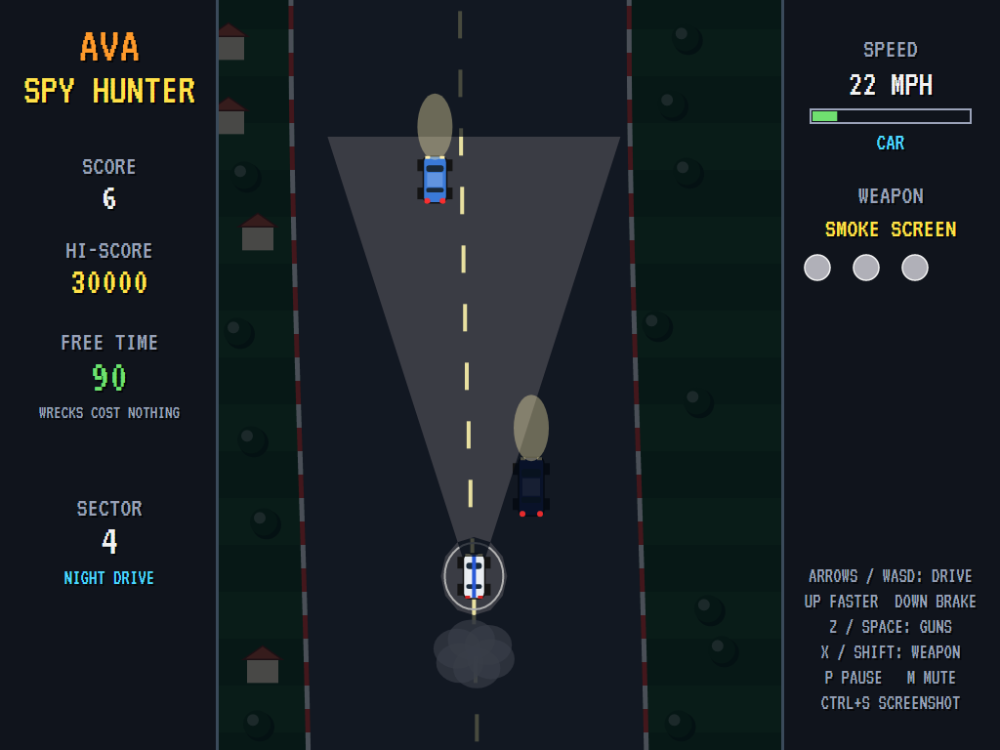 | 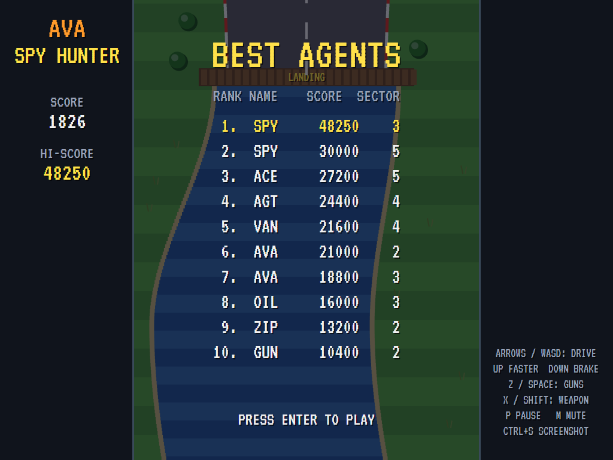 | |
| Headlights, and a smoke screen behind. | The high-score table. | |

The screenshots are made by the tests, which play the game in a real (headless) window; see
[Tests](#tests).

## Download and run

Ready-to-run builds for Windows, macOS and Linux, on both Intel/AMD and ARM, are on the
[Releases page](https://github.com/Harlock123/AVASPYHunter/releases/tag/latest). **Latest build** is
rebuilt on every push to `main`. Each download is one self-contained executable: no .NET install is
needed.

| Platform | Archive |
|---|---|
| Windows | `AVASPYHunter-win-x64.zip`, `AVASPYHunter-win-x86.zip`, `AVASPYHunter-win-arm64.zip` |
| macOS | `AVASPYHunter-osx-arm64.tar.gz` (Apple silicon), `AVASPYHunter-osx-x64.tar.gz` (Intel) |
| Linux | `AVASPYHunter-linux-x64.tar.gz`, `AVASPYHunter-linux-arm64.tar.gz`, `AVASPYHunter-linux-arm.tar.gz` |

```bash
tar -xzf AVASPYHunter-linux-x64.tar.gz     # or linux-arm64, linux-arm, osx-arm64, osx-x64
./AVASPYHunter
```

On Windows, unzip and run `AVASPYHunter.exe`. On macOS, if Gatekeeper refuses to open it, run
`xattr -d com.apple.quarantine AVASPYHunter` once. Run with `--no-audio` for silence.

**Sound** comes through OpenAL Soft, built in for every platform. In a virtual machine the game
detects it and uses a larger audio buffer, so the sound doesn't break up.

**Gamepads** use SDL2, which is bundled for Windows, macOS and Intel/AMD Linux. ARM Linux builds need it
installed; without it the keyboard still works:

```bash
sudo apt install libsdl2-dev            # Debian / Ubuntu / Raspberry Pi OS
sudo pacman -S --needed sdl2-compat     # Arch / Omarchy
```

## Controls

| Input | Action |
|-------|--------|
| **Enter** / **Space** | Start |
| **Left** / **Right** (or **A** / **D**) | Steer |
| **Up** / **W** (hold) | Faster |
| **Down** / **S** (hold) | Brake |
| **Z** / **Space** / **Ctrl** (hold) | Guns |
| **X** / **Shift** | The special weapon: oil, smoke or a missile |
| **P** / **Esc** | Pause (Esc again to quit) |
| **M** | Mute |
| **Ctrl+S** / **Cmd+S** | Save a screenshot to the Pictures folder |

**Gamepad**: left stick or D-pad to drive, **A** for the guns, **B** or **Y** for the special weapon,
**Start** to start and pause, **Back** (while paused) to quit.

**Entering initials**: type letters, or dial with **Up**/**Down** and accept with **Space**; **Left** /
**Backspace** go back; **Enter** finishes.

## Scoring

| What | Points |
|---|---:|
| The road covered | 1 for every 12 pixels |
| A razorwheel | 150 |
| A sedan | 500 |
| A bulldog | 700 |
| A barge, a torpedo boat | 400, 500 |
| A drum in the river | 50 |
| The helicopter | 1,500 |
| Docking with the armoury van | 250 |
| Each new sector | 1,000 |
| Harming an innocent | no score for eight seconds |
| Extra car | at 20,000, then every 30,000 |

## Tests

```bash
dotnet test AVASPYHunter.slnx
```

The engine has no UI and runs in fixed 60 Hz steps, so it plays the same at any frame rate, and a seed
always plays the same game. The tests check:

- **The road**:
  - **Its shape:** always the same for a seed, always wide enough, and with forks, bridges and rivers.
  - **The country:** the four stretches coming round in turn.
- **Driving**:
  - **The start:** rolling out of the van.
  - **The controls:** speeding up, braking and steering.
  - **Wrecks:** leaving the road wrecks the car, free time makes it cost nothing, and after that the cars run out.
- **Fighting**:
  - **The guns:** stopping a razorwheel but bouncing off a bulldog, and a sedan taking three hits.
  - **Innocents:** harming one stops the score.
  - **Bumping:** shoving a raider off the road scores.
  - **Their attacks:** a razorwheel's blades shredding the tyres, and the gunman's shot.
- **The armoury**:
  - **The van:** docking gives a weapon.
  - **Oil and smoke** spin out pursuers.
  - **The helicopter:** only missiles bring it down, and its bombs wreck the car and leave craters.
- **The river**:
  - **The boathouse and the landing:** the car becomes a boat and back again.
  - **Drums** sink boats, and bullets sink drums.
- **The machine**:
  - **Points:** for distance, and the extra car.
  - **The cycle:** the title, demo and high-score table taking turns.
  - **Initials, pause, and every sound.**

The computer driver must get well down the road with three different seeds.

The screenshot tests draw the real screen in a headless window. To refresh the README's pictures:

```bash
SPY_SHOTS=$PWD/Images dotnet test tests/AVASPYHunter.Tests --filter ScreenshotTests
```

To see how far the computer driver gets in four minutes, and what wrecks it (for tuning):

```bash
SPY_PROBE=1 dotnet test tests/AVASPYHunter.Tests --filter PilotProbe --logger "console;verbosity=detailed"
```

## Building

```bash
dotnet build AVASPYHunter.slnx
dotnet run --project src/AVASPYHunter
```

Needs the .NET 10 SDK. The sounds are made by `tools/make_sounds.py` (standard-library Python):
`python3 tools/make_sounds.py` rewrites `src/AVASPYHunter/Sounds`.

## Project structure

```
AVASPYHunter/
├── AVASPYHunter.slnx
├── src/AVASPYHunter/
│   ├── Engine/
│   │   ├── GameEngine.cs        # States, the title and demo cycle, free time, cars and the music
│   │   ├── GameEngine.Play.cs   # Driving, traffic and the raiders, guns and the armoury, the
│   │   │                        # helicopter, the river, bumps and wrecks
│   │   ├── Track.cs             # The road: bends, narrows, forks, bridges, boathouses and rivers
│   │   ├── Entities.cs, Geometry.cs
│   │   ├── AttractPilot.cs      # The computer driver for the demonstration (and the tests)
│   │   ├── HighScoreTable.cs, InitialsEntry.cs
│   │   ├── InputHandler.cs, ControllerManager.cs  # Keys and an SDL2 gamepad
│   │   └── SoundManager.cs      # Effects, the driving music and the tunes through OpenAL
│   ├── Audio/                   # The OpenAL engine (from the author's AVABand)
│   ├── Views/                   # The road and its country, the vehicles, the helicopter, the panels
│   └── Sounds/                  # The synthesised effects and tunes
├── tests/AVASPYHunter.Tests/    # Gameplay, screenshot and driver tests
├── tools/make_sounds.py
└── Images/                      # Screenshots
```

## About and licence

AVA Spy Hunter © 2026 Lonnie Watson, under the [MIT License](LICENSE).

*Spy Hunter* © 1983 Bally Midway; the name belongs to its current owner. AVA Spy Hunter is an
independent, unofficial game in its style. Its road, vehicles, enemies, graphics, sounds, tunes and
code are its own; nothing is taken from the arcade machine's program, graphics, sound or music (its
driving theme included). It is not affiliated with or endorsed by any rights holder.
